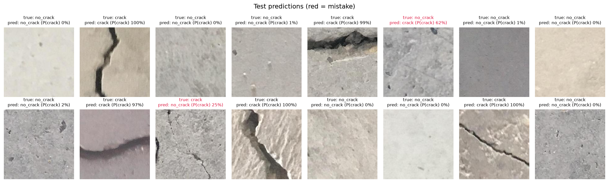
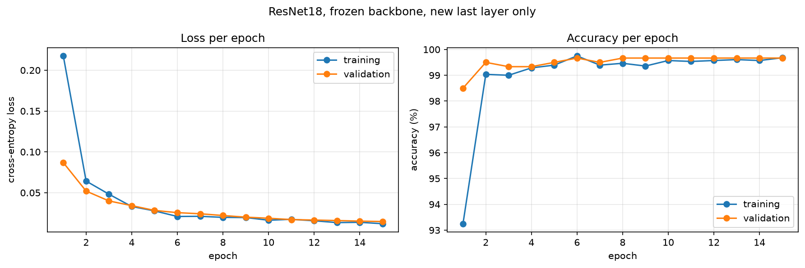
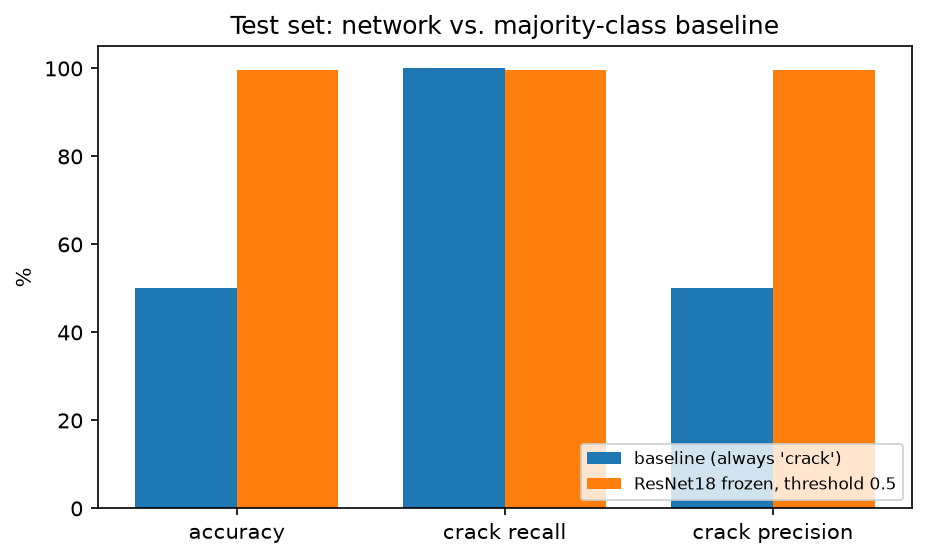
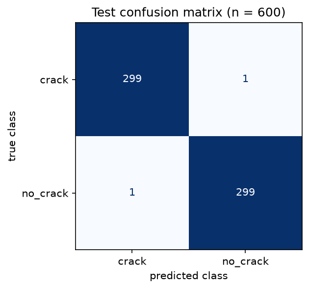
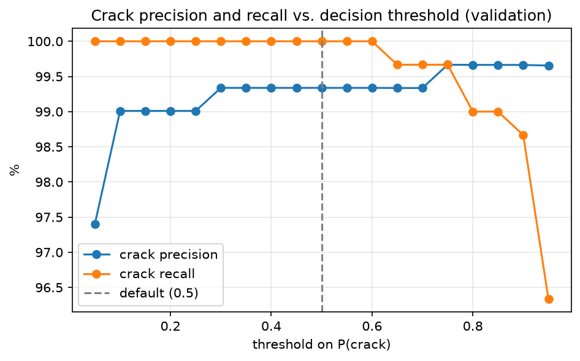
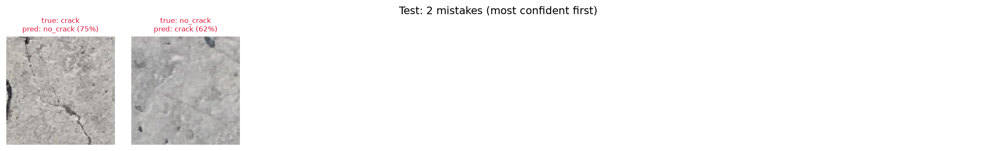
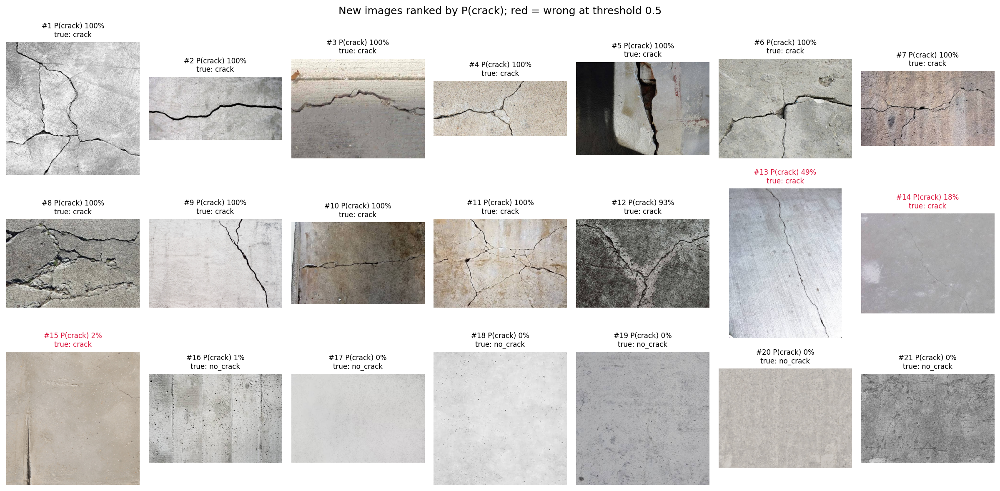

# Crack / no-crack classifier for concrete inspection photos

**Team:** Ugo, Alvaro, Sneha Shenoy
**Course:** AI Methods I – Day 4: Neural networks and computer vision (IAAC MaAI 2026/27)
**Track:** A2 (image classifier)
**Model on Hugging Face:** https://huggingface.co/iaac-maai/day4-group7-crack-classifier


*Test images with the true class, the predicted class and P(crack). Red titles are mistakes: the model gets 598 of 600 test images right.*

## Use case

A facility manager or inspection engineer has a few thousand close-up photos of concrete walls and wants to know which ones an engineer should look at first. The model gives every photo a probability of showing a crack, so the photos can be sorted and the likely cracks checked first. A **missed crack** (false negative) can leave a structural problem unchecked, while a **false alarm** (false positive) only costs an engineer about a minute, so we optimise for **crack recall** first and precision second.

## Dataset

| | |
|---|---|
| **Name** | Concrete Crack Images for Classification (METU) |
| **Source** | Özgenel, Ç. F. (2019), [Mendeley Data, DOI 10.17632/5y9wdsg2zt.2](https://data.mendeley.com/datasets/5y9wdsg2zt); downloaded from the Kaggle mirror [`arunrk7/surface-crack-detection`](https://www.kaggle.com/datasets/arunrk7/surface-crack-detection) |
| **Size** | 40,000 RGB images of 227 × 227 px (20,000 crack, 20,000 no crack), cut from 458 photos of METU campus buildings. We use a random sample of **4,000** (2,000 per class): 2,800 train / 600 validation / 600 test, stratified by class |
| **Licence** | CC BY 4.0 |

For the application (notebook section 7) we also used **21 concrete images from the web** (15 crack, 6 no crack), labelled by eye. They are not committed and not redistributed, because we do not own their copyright.

## Repository structure

```
├── data/                 # downloaded data (not committed): images/ (the split), own_photos/ (new images)
│   └── .gitkeep
├── figures/              # the plots exported by the notebook, shown in this README
├── models/               # model card (README.md) and its figures; model.pt lives on Hugging Face
├── notebook/
│   └── neural_network.ipynb   # the full pipeline: data → baseline → training → evaluation → application
├── .gitignore
├── LICENSE
├── README.md
└── requirements.txt
```

## How to run

```bash
python -m venv .venv
source .venv/bin/activate        # Windows: .venv\Scripts\activate
pip install -r requirements.txt
```

Open `notebook/neural_network.ipynb` **from inside the `notebook/` folder**, select the `.venv` kernel and run all cells. The notebook downloads the dataset with `kagglehub`; if Kaggle asks for a login, download it by hand and unzip it into `data/raw/` (it finds the `Positive/` and `Negative/` folders by itself). For section 7, put labelled images named `crack_XX.jpg` / `nocrack_XX.jpg` in `data/own_photos/`.

Training ran on a **MacBook Pro (Apple Silicon, PyTorch `mps` backend)**: 2.7 minutes for the frozen model and 1.9 minutes more for the fine-tuning experiment. Set `TRAIN = False` to skip training and use the published weights from Hugging Face.

## Approach

- **Architecture:** ResNet18 pretrained on ImageNet, all layers frozen, last layer replaced by `nn.Linear(512, 2)`: 11.2 million parameters, of which **1,026 trainable**.
- **Training:** Adam, learning rate 1e-3, batch size 32, up to 15 epochs with early stopping on the validation loss (patience 3), keeping the best weights. BatchNorm layers are kept in evaluation mode so the frozen features do not drift.
- **Augmentation:** random resized crop (scale 0.7–1.0), horizontal and vertical flips, rotations by 0/90/180/270°, brightness and contrast jitter. Preprocessing: the ImageNet transforms of ResNet18 (resize, centre crop 224 × 224, normalise).
- **Baseline:** majority class. With balanced classes it always predicts `crack`: 100% crack recall, but it flags every photo.
- **Experiment:** frozen backbone vs. also fine-tuning the last block (`layer4`, learning rate 1e-4), compared on validation.
- **Threshold:** chosen on validation with a precision/recall sweep: **0.5**, in the middle of the range 0.3–0.6 where crack recall stays at 100%.

## Results

| Model | Accuracy (test) | Crack precision | Crack recall |
|---|---|---|---|
| Baseline: always `crack` | 50.0% | 50.0% | 100.0% |
| **ResNet18, frozen backbone, threshold 0.5** | **99.7%** | **99.7%** | **99.7%** |
| Same model on 21 new web images | 86% | 100% | 80% |

| Experiment (validation) | Accuracy | Crack recall | Trainable parameters | Time |
|---|---|---|---|---|
| **Frozen backbone (kept)** | **99.7%** | **100.0%** | 1,026 | 2.7 min |
| + `layer4` fine-tuned | 99.5% | 99.3% | 8.4 million | 4.5 min |


*Validation loss keeps falling until epoch 15, but validation accuracy is flat at 99.7% from epoch 6: later epochs only make the model more confident. Training and validation stay close, so there is no overfitting.*


*The baseline finds every crack only by flagging every photo (50% precision). The network keeps almost all of that recall with 99.7% precision.*


*Test set: 299 of 300 cracks found, 1 false alarm in 300 plain surfaces.*


*Crack recall stays at 100% on validation up to a threshold of 0.6; we use 0.5, in the middle of that safe zone.*


*The two test mistakes: a thin, low-contrast crack next to a dark hole (missed, 75% "no crack") and a faint scratch (false alarm, 62% "crack"). Both are about thin, faint lines.*


*21 new images ranked by P(crack). All wide cracks are found with ≥ 93% confidence and no plain surface is flagged, but 3 hairline cracks photographed from further away are missed (red): accuracy falls from 99.7% to 86%.*

## Limitations

- **Optimistic test score:** the 40,000 patches come from only 458 photos and the dataset does not say which patch comes from which photo, so we could not split by source. Patches of the same wall can be in both training and test.
- **Hairline cracks and scale:** the training cracks are mostly wide and fill the patch. On new images, hairline cracks in wider photos are missed (crack recall 80% on 21 web images).
- **Narrow data:** bare concrete from one university campus in Turkey. Unknown performance on plaster, brick, painted or wet walls, or drone images.
- **Label noise:** at least one validation image labelled "no crack" seems to show a real crack.
- **No location and no severity:** it classifies the whole image; it does not say where the crack is or how dangerous it is.
- **Not for** structural safety decisions without an engineer. It is a screening aid to sort photos.

## AI usage disclosure

| | |
|---|---|
| **Tools** | Claude agent |
| **Why** |  To get a working A2 notebook skeleton that follows the brief, and draft the documentation |
| **Where** |  Notebook structure and code; README and the model card |

**Lessons learned:** Double check conclusions.

## License

Code released under the [MIT License](LICENSE). The model is released under the MIT License (see the model card). The training data is subject to its own licence (CC BY 4.0, Özgenel 2019).
